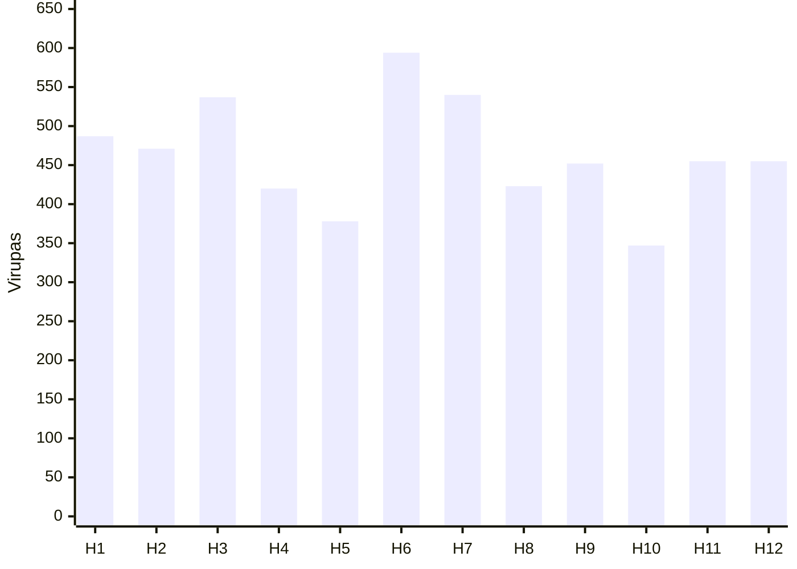

# Why check Bhava Bala before the planet? {#bhava-first}

**House first, then sign, then graha.** A strong planet on a weak house is talent without a platform — results in that life area stay hard to unlock.

- Bhava Bala scores the house as charged space; without it, Shadbala alone overstates what can happen.
- On Vedaansh, totals are Rupas (`totalRupa`); lecture bands often quote Virupas (×60).
- Raman-style floor used in code: ≥ 7.5 Rupas (450 Virupas) counts as strong.
- Relative origin vs destination strength decides who dominates when a lord moves house.

@answer scope="Bhava Bala Part 4 · Vedaansh Rupas · sample chart from session audio"
@meta locale=en
@source lecture title="Bhava Bala lecture notes (practitioner heuristics)"
@source engine title="Bhava Bala calculation" path=src/lib/engine/bhavaBala.ts lines=1:246
@source ui title="Bhava Bala strength bands" path=src/components/ui/BhavaBalaVisuals.tsx lines=22:33
@source bphs title="BPHS Ch.28 (engine header)" path=src/lib/engine/bhavaBala.ts lines=1:11

## What is Bhava Bala? {#what}

Bhava Bala is house strength. It folds the lord’s Shadbala, the house’s digbala, and aspect pressure on the cusp into one score per house.

@facts
| Order of reading | House → Rashi → Graha |
| House role | Platform / opportunity |
| Planet role | Talent / capability |
| Formula | Adhipati + Digbala + Drishti |
| Vedaansh unit | `totalRupa` (Virupas ÷ 60) |
| Strong floor (code) | ≥ 7.5 Rupas (450 Virupas) |
| Soft high band (lecture) | ~400–550+ Virupas |

@callout level=note title="Units"
| Lecture audio often says 400, 450, 500 — that is Virupas.
| Vedaansh Bhava tab shows Rupas. Divide Virupas by 60, or multiply Rupas by 60.
| 7.5 R = 450 V; 6 R = 360 V; 9 R = 540 V.

## How is the score built? {#formula}

@workflow id=bhava-parts title="Three parts of Bhava Bala"
| lane lord | Lord |
| lane place | Place |
| lane aspect | Aspects |
| adip | Adhipati Bala | backend | lord |
| dig | Bhava Digbala | backend | place |
| dri | Bhava Drishti | backend | aspect |
| adip > dig | |
| dig > dri | |

@steps id=parts-steps
| adip | Adhipati Bala | Sign lord’s total Shadbala (Virupas) for that house’s Rashi. | bhava-parts | adip |
| dig | Bhava Digbala | Sign category vs zero-kendra; arc ÷ 3, max 60 Virupas. | bhava-parts | dig |
| dri | Bhava Drishti | Sputa aspects on the cusp; Ju/Me full; others ±¼; nodes out. | bhava-parts | dri |

## How do you analyse a chart? {#method}

@workflow id=bhava-method title="Bhava analysis flow"
| lane scan | Scan |
| lane compare | Compare |
| lane act | Act |
| open | Open Bhava Bala tab | frontend | scan |
| twelve | Rank twelve house totals | backend | scan |
| band | Mark weak vs strong | backend | scan |
| lord | Trace house lords | backend | compare |
| move | Origin vs destination | backend | compare |
| remedy | Vastu or house remedies | external | act |
| open > twelve | |
| twelve > band | |
| band > lord | |
| lord > move | |
| move > remedy | |

@steps id=method-steps
| open | Open Bhava Bala tab | Chart → Bhava Bala; read totals and strongest/weakest. | bhava-method | open |
| twelve | Rank twelve house totals | Note peaks near 9R+ and dips under ~6R. | bhava-method | twelve |
| band | Mark weak vs strong | Code: ≥7.5R strong. Lecture soft: 400–550+ Virupas = charged. | bhava-method | band |
| lord | Trace house lords | For each topic house, find its lord and that lord’s own Shadbala. | bhava-method | lord |
| move | Origin vs destination | Compare origin house strength to the house where the lord sits. | bhava-method | move |
| remedy | Vastu or house remedies | Weak house → direction/Vastu plus house-specific remedial acts. | bhava-method | remedy |

## Platform vs talent {#platform}

| Situation | Read as |
| --- | --- |
| Strong planet, weak house | Platform issue {caution:Bhava weak} |
| Strong house, weak planet | Capability issue {caution:Graha weak} |
| Both strong | Area can deliver {good:Charged + able} |
| Both weak | Hard life area {bad:Low charge} |

Cricket shorthand from the lecture: player = graha; tournament = bhava. Talent in a small league still cannot create big opportunities; a big stage without form still fails.

## Origin and destination {#supply}

When a house lord leaves House A for House B: **A is supply (origin), B is demand (destination).**

| Pattern | Typical read |
| --- | --- |
| Strong origin → weak destination | Lord dominates the landing house {good:Upper hand} |
| Weak origin → strong destination | Destination themes press the native {caution:Demand wins} |
| Strong 1st lord in weak 8th | Native can exploit / hold upper hand {caution:Power tilt} |
| Strong 8th lord in weak 1st | Native absorbs crisis / humiliation risk {bad:Overwhelm} |

@callout level=warning title="Relative, not absolute"
| A high origin number alone does not guarantee comfort in the destination.
| Compare both houses, then the planet’s own Shadbala.
| 1st–8th examples are diagnostic patterns, not moral labels.

## Soft bands vs Vedaansh UI {#bands}

| Question | Lecture soft (Virupas) | Vedaansh check (Rupas) |
| --- | --- | --- |
| House feels charged | ~400–550+ {good:Fewer snags} | ≥ 7.5 (450 V) {good:Strong flag} |
| Usable / mid | ~350–400 {caution:Mixed} | 6–7.5 {caution:Average} |
| Weak / needs support | ~275–280 or lower {bad:Low charge} | &lt; 6 {bad:Weak} |
| Excellent UI tint | — | ≥ 9 (540 V) {good:Excellent} |

## Sample twelve-house scan {#sample}

Session Virupa totals for one chart (approx.; audio read fast).

In that sketch, H6 and H3 lead; H10 and H5 lag — start diagnosis on the weak houses and their lords, not on the strongest planet alone.

## Remedies when a house is weak {#remedies}

| Lever | Use when |
| --- | --- |
| Vastu / direction | House score low and space feels blocked |
| House-specific remedies | Lord and cusp both weak |
| Do not skip Shadbala | Planet still must carry the act |

Goal: raise usable charge in that life area; remedies support living the house, they do not rewrite the math.

## What should you verify on Vedaansh? {#check}

- [ ] Open chart → Bhava Bala and read all twelve `totalRupa` values.
- [ ] Note strongest and weakest houses; convert to Virupas (×60) if matching lecture bands.
- [ ] For a life question, start with that house’s score before the planet’s Shadbala.
- [ ] Trace the house lord: compare origin house strength to the house where the lord sits.
- [ ] Treat ≥ 7.5 R as the code’s strong floor; treat &lt; 6 R as priority for remedies.
- [ ] Pair 1st–8th lord exchanges with this relative-strength rule before predicting power dynamics.
