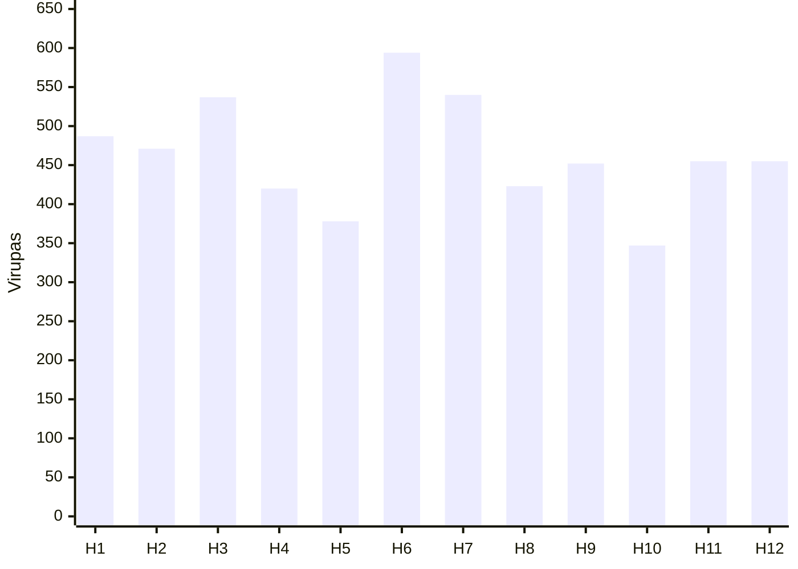

# Why does Bhava Bala come before the planet? {#why-first}

**House → Rashi → Graha.** If the house is weak, strong Shadbala and a clean sign still cannot unlock that life area — the platform is uncharged.

- High Bhava Bala (~400–550+ Virupas) means fewer snags; effort in that area pays.
- Low Bhava Bala means the space lacks energy to support outcomes.
- House = platform; planet = talent — diagnose which one failed.
- On Vedaansh, read Rupas (`totalRupa`); ×60 to match lecture Virupas.

@answer scope="Shadbala Part 4 lecture · Vedaansh Rupas · session sample chart"
@meta locale=en
@source lecture title="Bhava Bala lecture notes (practitioner heuristics)"
@source engine title="Bhava Bala calculation" path=src/lib/engine/bhavaBala.ts lines=1:246
@source ui title="UI strength bands" path=src/components/ui/BhavaBalaVisuals.tsx lines=22:33
@source nav title="Bhava Bala tab" path=src/lib/ui/navConfig.ts lines=128:128

## What order should you analyse? {#order}

@workflow id=read-order title="Analysis sequence"
| lane read | Read |
| bhava | House | backend | read |
| rashi | Sign | backend | read |
| graha | Planet | backend | read |
| bhava > rashi | first |
| rashi > graha | then |

@steps id=order-steps
| bhava | House | Base energy for that life area; without charge, results stall. | read-order | bhava |
| rashi | Sign | Dignity and environment of the house. | read-order | rashi |
| graha | Planet | Talent and timing once the platform exists. | read-order | graha |

Bhava Bala folds Shadbala of the lord, sign-based digbala, and aspects on the cusp — so it sits inside the Shadbala system, not beside it.

## Platform vs talent {#cricket}

| Situation | Diagnosis |
| --- | --- |
| Strong planet, weak house | No platform {caution:Bhava issue} |
| Strong house, weak planet | No consistency {caution:Graha issue} |
| Both strong | Area can deliver {good:Charged} |
| Both weak | Hard life area {bad:Low charge} |

Lecture cricket shorthand: talent in a small league still cannot create big opportunities; a world stage without form still fails.

Example life area: weak 7th → relationship difficulty; strong 7th → easier entry into partnership.

## Origin supply vs destination demand {#supply}

When a house lord leaves House A for House B: **A = supply (origin), B = demand (destination).** Origin strength travels with the lord; relative gap decides who dominates.

| Pattern | Read |
| --- | --- |
| Strong origin → weak destination | Lord dominates landing house {good:Upper hand} |
| Weak supply vs high demand | Destination themes win {caution:Demand wins} |
| Strong 4th lord into 9th | Comforts may support higher path if 9th can receive |
| Weak 6th into strong 9th | Job supply cannot fund heavy study demand {bad:Cannot balance} |

@callout level=note title="Worked numbers from the lecture"
| Strong 7th (700) lord into weak 3rd (300): 7th energy performs well in the 3rd.
| Strong Lagna lord into weak 8th: native holds upper hand (exploit tilt).
| Strong 8th lord into weak Lagna: crisis energy overwhelms the native (victim tilt).
| Always compare both houses, then the planet’s own Shadbala.

@callout level=warning title="1st–8th is relative power"
| These are diagnostic tilts from relative Bhava Bala, not moral labels.
| Confirm lord placement and dasha before prediction.

## Soft bands and Vedaansh {#bands}

| Band | Lecture (Virupas) | Vedaansh (Rupas) |
| --- | --- | --- |
| Charged / fewer problems | ~400–550+ {good:High} | ≥ 7.5 Strong; ≥ 9 Excellent {good:UI} |
| Mid | ~350–400 {caution:Mixed} | 6–7.5 Average |
| Weak / remedies | ~275–280 or lower {bad:Low} | &lt; 6 Weak {bad:Priority} |

Code marks `isStrong` at ≥ 7.5 Rupas (450 Virupas).

## Session sample (twelve houses) {#sample}

Session Virupa totals for one chart (approx.; audio read fast).

H6 and H3 lead; H10 and H5 lag — start with weak houses and their lords.

## How to check in Vedaansh {#vedaansh}

@workflow id=app-check title="Check Bhava Bala in app"
| lane app | App |
| open | Open chart | frontend | app |
| tab | Bhava Bala tab | frontend | app |
| read | Rank twelve Rupas | backend | app |
| convert | ×60 for lecture bands | backend | app |
| open > tab | |
| tab > read | |
| read > convert | |

@steps id=app-steps
| open | Open chart | Home or public chart; recalculate if data missing. | app-check | open |
| tab | Bhava Bala tab | Sidenav Bhava Bala; modern/classic component views. | app-check | tab |
| read | Rank twelve Rupas | Note strongest/weakest cards and dips under 6R. | app-check | read |
| convert | ×60 for lecture bands | 7.5 R = 450 V; match soft 400–550+ talk. | app-check | convert |

Other software may hide this under “Other Strength”; in Vedaansh it is a first-class tab.

## Remedies for weak houses {#remedies}

| Lever | When |
| --- | --- |
| Vastu / house direction | Score low and space feels blocked |
| House-specific remedies | Lord and cusp both weak |
| Still check Shadbala | Planet must carry the act |

Goal: raise usable charge in that life area. Remedies support living the house; they do not rewrite natal math.

## Practice checklist {#check}

- [ ] For any topic, read that house’s Bhava Bala before the planet’s Shadbala.
- [ ] In Vedaansh, open Bhava Bala and note strongest and weakest houses.
- [ ] Convert Rupas × 60 when comparing to lecture Virupa bands.
- [ ] Trace the topic lord: compare origin house strength to destination house strength.
- [ ] For 1st–8th lord exchanges, apply the relative upper-hand / overwhelm rule.
- [ ] If a house is near ~275–280 Virupas (&lt; ~4.7 R), plan Vastu and house remedies.
